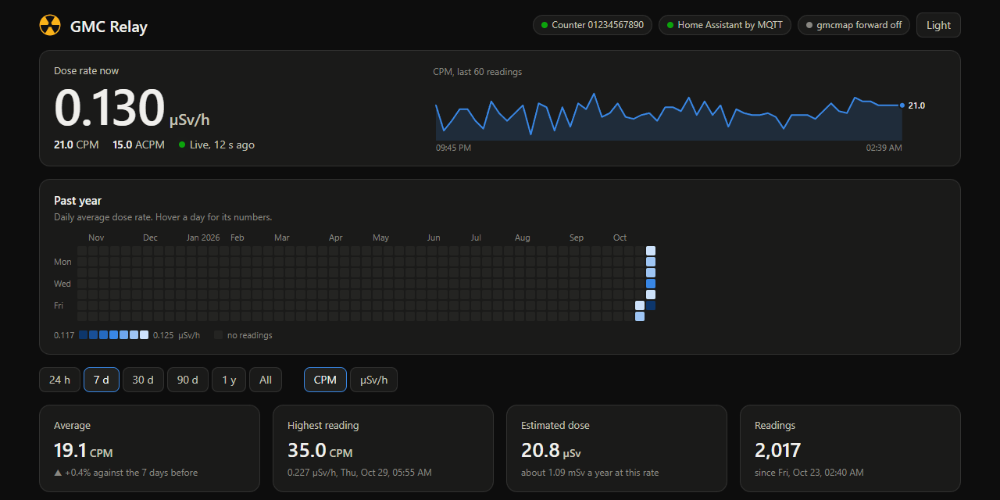
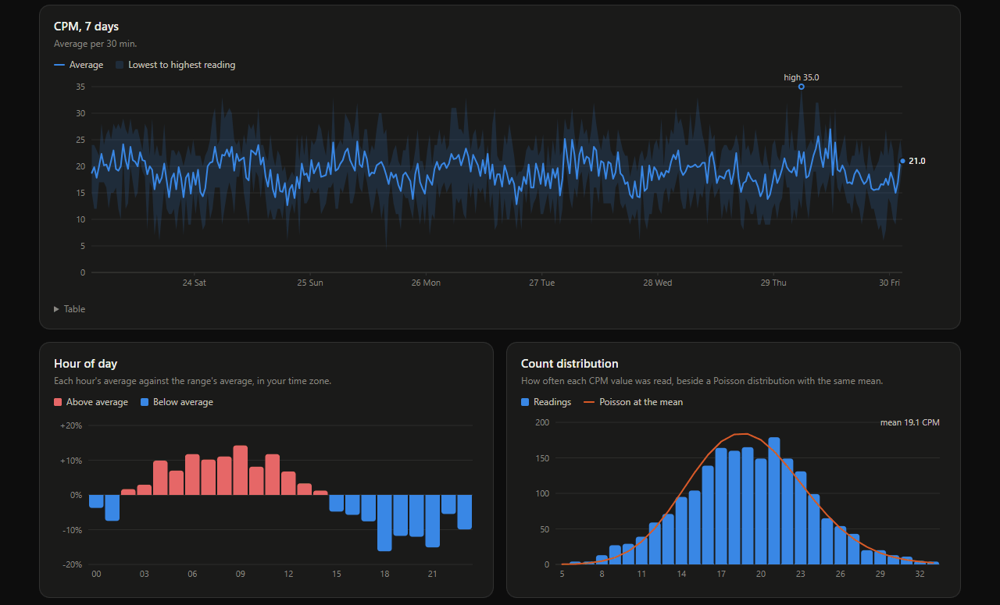

# GMC Relay for Home Assistant

A Home Assistant app that receives a GQ GMC Geiger counter's WiFi upload on port 80, turns it into Home Assistant sensors through MQTT discovery, and forwards it to gmcmap.com so the public map keeps updating. A sidebar panel graphs the history it keeps.

[](https://my.home-assistant.io/redirect/supervisor_add_addon_repository/?repository_url=https%3A%2F%2Fgithub.com%2Fheidrickla%2Fha-gmc-relay)
[](https://my.home-assistant.io/redirect/supervisor_addon/?addon=193d9a14_gmc_relay&repository_url=https%3A%2F%2Fgithub.com%2Fheidrickla%2Fha-gmc-relay)

## Screenshots



The panel's top half, with a week of example readings.



The chosen range as a chart, each hour against the range's average, and the count distribution.

## Setup

1. Install the Mosquitto broker app and set up the MQTT integration Home Assistant offers for it, if they are not there already.
2. Add this repository with the first button, then install GMC Relay with the second and start it. No option needs setting.
3. On the counter, set Website (Menu, WiFi, Website) to the Home Assistant host's LAN address.

The first counter to upload is accepted, and a Geiger counter device appears with `sensor.geiger_meter_cpm`, `sensor.geiger_meter_acpm`, `sensor.geiger_meter_usv` and `sensor.geiger_meter` (last reading). Works with the GMC-320+, 500, 500+, 600 and 600+ with WiFi.

## Options

All optional.

| Option | Default | Effect |
|---|---|---|
| `counter_ids` | empty | Accepted counter `GID` values. Empty accepts the first counter to upload. |
| `forward` | on | Replay each upload to gmcmap.com. |
| `forward_url` | `https://www.gmcmap.com` | Where uploads are replayed. |
| `webhook_id` | empty | Send readings to this Home Assistant webhook instead of MQTT, for an existing template sensor. |
| `core_url` | `https://homeassistant:8123` | Where the webhook is posted. |
| `core_verify_tls` | on | Check Home Assistant's certificate for the webhook. |
| `log_level` | info | `debug` logs every request. |

The app's Documentation tab ([DOCS.md](gmc_relay/DOCS.md)) covers the entities, the panel, importing history and moving off a webhook template sensor.

## Developing

```bash
python -m pip install ruff pytest yamllint shellcheck-py
ruff check . && ruff format --check . && python -m pytest
```

The app runs on the base image's Python 3.14; test under the same version.

## Licence

MIT. See `LICENSE`.
